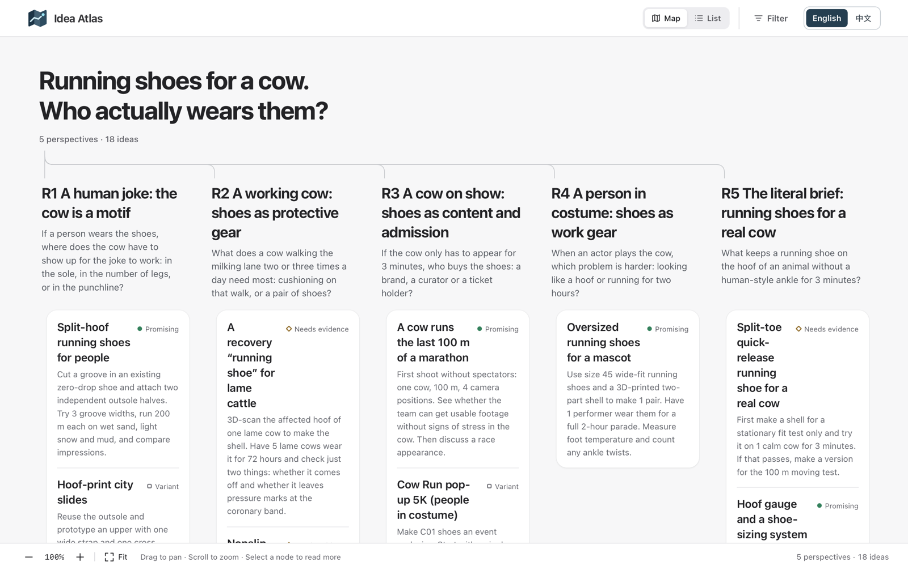
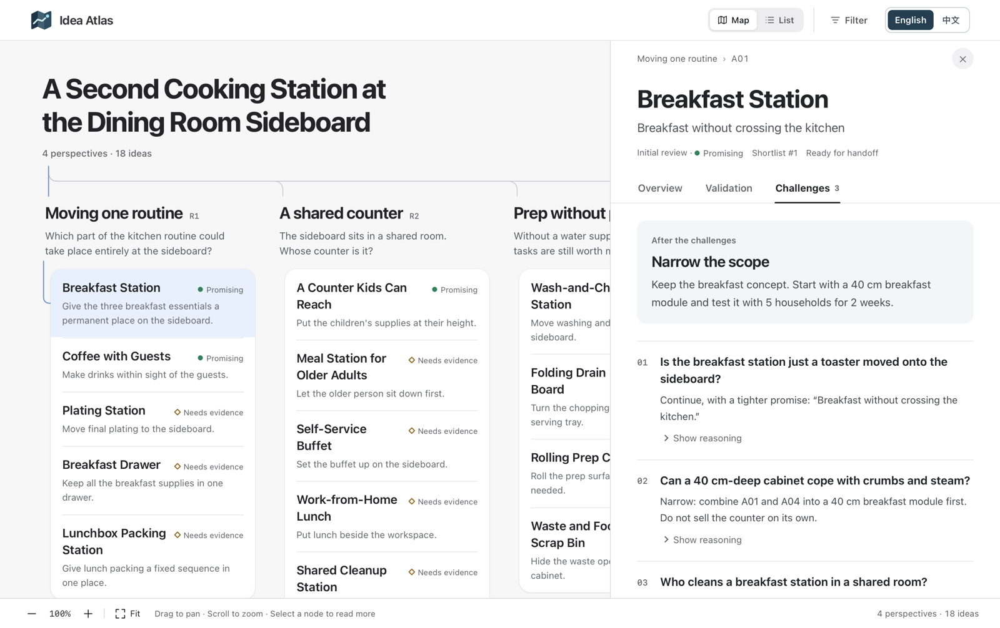

# Idea Atlas

[中文说明](README.zh-CN.md)

Idea Atlas is an agent skill for the early stages of design. Give it a brief and it builds a map of possible directions. Open a card to see who would use the idea, what they do today, why they might switch, and what result would make you drop it. You can send the finished map to a teammate as a single HTML file that opens offline.

Paste this into Codex and replace `[your design brief]` with your topic.

> Install the Idea Atlas skill from https://github.com/gyy320603-star/idea-atlas and use it to explore [your design brief].

## [Try the demo](https://idea-atlas-demo.sturdypalm7.chatgpt.site/)

**Running shoes for a cow** · 5 ways to read the brief, 18 ideas, 7 shortlisted. Start with “Who wears the shoes?” Open C01 to see how the hoof-print joke turned into a split-sole shoe for a human runner. Its two challenges explain why a recognizable footprint and a pain-free 10 km run became separate tests. [English edition](https://idea-atlas-demo.sturdypalm7.chatgpt.site/cow-shoes/en.html) · [Chinese original](https://idea-atlas-demo.sturdypalm7.chatgpt.site/cow-shoes/zh.html)

[](https://idea-atlas-demo.sturdypalm7.chatgpt.site/cow-shoes/en.html)

**A second prep station in the dining room** · 4 ways to read the brief, 18 ideas, 6 shortlisted. Open A01 and select **Challenges**. Crumbs, steam and the question of who wipes the counter narrowed the breakfast station to a 40 cm module with a washable tray. D04 records why a full second kitchen was dropped. [English edition](https://idea-atlas-demo.sturdypalm7.chatgpt.site/sideboard/en.html) · [Chinese original](https://idea-atlas-demo.sturdypalm7.chatgpt.site/sideboard/zh.html)

[](https://idea-atlas-demo.sturdypalm7.chatgpt.site/sideboard/en.html)

Both examples are first runs generated in Chinese with **Hermes** and **DeepSeek V4.1 Flash 1017**. The cow-shoe run used Idea Atlas 0.14.1 and the sideboard run used 0.13.0. Both are shown in the 1.0.0 viewer, with a separate English translation of each original. The tests in the cards are proposals.

## What the skill does

- **Find distinct starting points.** When the audience or purpose is open, the agent explores competing readings of the brief. For a concrete assignment it explores different ways to intervene, including changing a physical action, the moment it happens or the person responsible.
- **Compare ideas against what people already do.** Each card names a user in a specific situation, the cheapest existing workaround, the proposed change and its tradeoffs. Similar ideas are linked as variants so you can see when several options depend on the same bet.
- **Plan a test and record what changed.** Cards distinguish supplied evidence from assumptions and name an observable result that would rule the idea out. For reviewed cards, you can follow the question, the evidence or counterexample considered, and the decision. The shortlist records why each candidate stays in consideration and what to check next.
- **Keep working from the result.** Browse the map, switch to a list or filter to the shortlist. The run also saves Markdown cards, decision records and the JSON used to render the map. Ask the agent to continue a particular card by ID when you want to develop it further.

## When to use it

| Direction | A brief worth trying |
| --- | --- |
| Product or industrial design | “Two people share a narrow kitchen before work. What part of breakfast could move elsewhere, and what extra cleaning would that create?” |
| Service or interaction design | “At a repair café, visitors keep asking if it’s their turn. Compare ways to signal progress without adding work for the volunteers.” |
| Speculative briefs and teaching | “Design a clock for someone who never looks at the time. Explore who might want one and what they would use it to decide.” |
| Choosing what to prototype | “Here are our workshop notes and sketches. Which ideas solve the same problem in different ways? What observation would change which one we prototype first?” |

A topic is enough to start. Add constraints, observations or existing alternatives when you have them. With the brief alone, the map gives you hypotheses and ways to test them. A place on the shortlist is a recommendation for your review.

## Install and run

1. From your project folder, install Idea Atlas for Codex with the [skills CLI](https://github.com/vercel-labs/skills) (requires Node.js 22.20+):

   ```sh
   npx skills add gyy320603-star/idea-atlas --skill idea-atlas -a codex
   ```

   Or download the [v1.0.0 skill ZIP](https://github.com/gyy320603-star/idea-atlas/releases/download/v1.0.0/idea-atlas-skill-1.0.0.zip) and extract it into your host’s skills directory. If you cloned the repository, copy its [idea-atlas folder](idea-atlas/) instead. Keep the whole folder together.

   | Host | Installed skill file | Invoke in a new chat |
   | --- | --- | --- |
   | Codex, in one project | `.agents/skills/idea-atlas/SKILL.md` | `$idea-atlas` |
   | Hermes, for your user account | `~/.hermes/skills/idea-atlas/SKILL.md` | `/idea-atlas` |

2. Start a chat in the project where you want the run saved and give your brief in your own words. In Codex, try the following prompt.

   > Use $idea-atlas to explore how visitors at a small library could leave a wet umbrella and find their own on the way out. We can’t drill into the building. Compare different approaches and tell me what would make you drop each one.

3. Open the returned `visual/atlas.html`. Select an idea and open **Validation** to see its evidence, proposed test and stopping condition. Cards with a recorded review also have a **Challenges** tab. The interface starts in English. **English / 中文** switches the buttons, filters and tabs. The brief, ideas and reviews follow the language of your request unless you specify another.

Idea generation uses your host agent’s model. The renderer requires Python 3.8+ and uses the standard library. The Hermes launcher requires a configured Hermes CLI. For another agent or a fresh run of the same brief, see the [host handoff guide](idea-atlas/references/independent-runs.md). The full release also includes [idea-to-positioning](companions/idea-to-positioning/), an optional companion for developing one shortlisted idea into a positioning argument.

## Rebuild a map

From a clone or the extracted full release, you can render an example directly from its JSON.

```sh
python3 idea-atlas/scripts/render_canvas.py docs/sideboard/en.json preview.html
```

Open `preview.html` in a browser. To render your own map, replace the JSON path with your run’s manifest. On Windows, use `py -3` if that is your Python launcher. [Manifest reference](idea-atlas/references/canvas-data.md)

The [full v1.0.0 release](https://github.com/gyy320603-star/idea-atlas/releases/download/v1.0.0/idea-atlas-1.0.0.zip) includes the skill, the companion and all four demo maps. Open [the gallery](docs/index.html) locally or serve `docs/` on a static host. Each case includes its original `zh.json` and translated `en.json`. To rebuild both ZIPs, run `python3 tools/package_release.py` from the repository root and find them in `dist/`.

Version 1.0.0 · [MIT License](LICENSE)

yuyang gong（龚雨旸）
