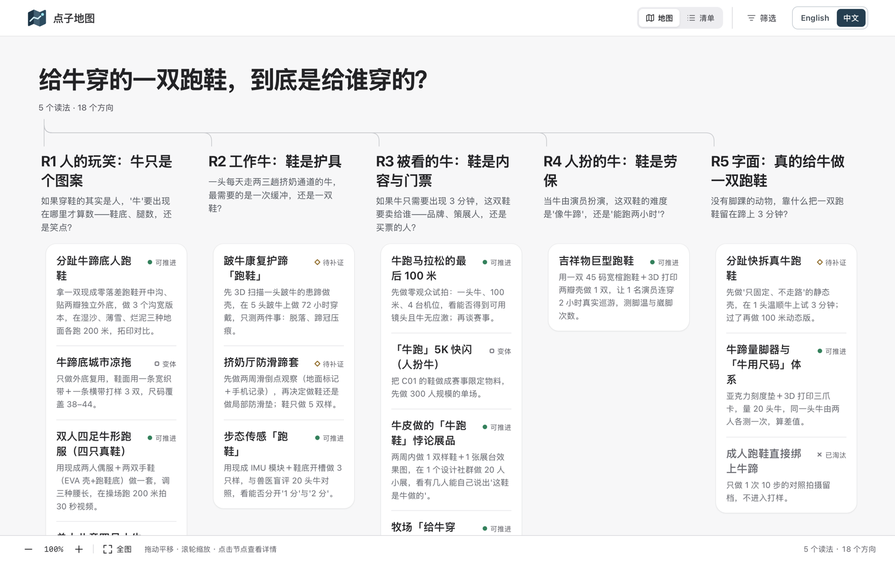
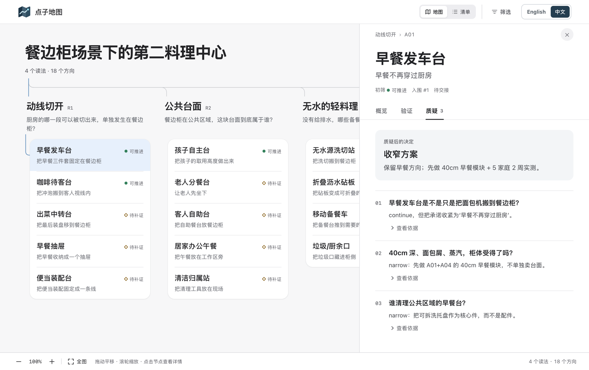

# 点子地图 · Idea Atlas

[English](README.md)

Idea Atlas 是一个用于设计前期探索的 agent skill。给它一个课题，就能得到一张可以点开阅读的想法地图。点开一张卡，就能看到谁会用、现在怎么做、为什么愿意换，以及出现什么结果就该放弃。生成的地图是一个独立的 HTML 文件，可以直接发给同事或老师，离线打开。

把下面这句话连同链接一起发给 Codex 或 WorkBuddy，将「我的课题」换成你的题目。WorkBuddy 手机端的链接安装已由作者实测；[WorkBuddy 使用与市场打包说明](integrations/workbuddy/README.md)。

> 从 https://github.com/gyy320603-star/idea-atlas 安装 Idea Atlas skill，然后用它帮我探索「我的课题」。

## [在线体验 Demo](https://idea-atlas-demo.sturdypalm7.chatgpt.site/zh.html)

**给牛穿的一双跑鞋** · 5 种读法，18 张卡，7 张入围。先看「究竟谁穿这双鞋」，再点开 C01。一个牛蹄印的玩笑怎么变成人穿的分趾跑鞋？两轮质疑把「别人能认出脚印」和「能无痛跑完 10 公里」变成了两个要分别验证的问题。[中文原稿](https://idea-atlas-demo.sturdypalm7.chatgpt.site/cow-shoes/zh.html) · [英文译本](https://idea-atlas-demo.sturdypalm7.chatgpt.site/cow-shoes/en.html)

[](https://idea-atlas-demo.sturdypalm7.chatgpt.site/cow-shoes/zh.html)

**餐边柜里的第二料理中心** · 4 种读法，18 张卡，6 张入围。打开 A01「早餐发车台」的「质疑」，看面包屑、蒸汽和「谁来擦台面」如何让方案收窄到一个带可拆洗托盘的 40 cm 早餐模块。再看 D04，比较「完整第二厨房」为何被淘汰。[中文原稿](https://idea-atlas-demo.sturdypalm7.chatgpt.site/sideboard/zh.html) · [英文译本](https://idea-atlas-demo.sturdypalm7.chatgpt.site/sideboard/en.html)

[](https://idea-atlas-demo.sturdypalm7.chatgpt.site/sideboard/zh.html)

两组案例都取自第一轮中文原稿，由 **Hermes** 搭配 **DeepSeek V4.1 Flash 1017** 生成。牛跑鞋使用 Idea Atlas 0.14.1，餐边柜使用 0.13.0。这里均用 1.0.0 前端重新渲染，并各附独立英文译本。卡片里的测试均为待执行的计划。

## 它能做什么

- **找到不同的出发点。** 当使用者或目的还不明确时，agent 会给同一题面找出几种值得分别探索的读法。若任务已经明确，则可以从人的动作、事情发生的时机、谁来负责等角度寻找不同做法。
- **把点子放回真实选择里比较。** 每张卡会写清谁在什么场景里遇到问题、眼下最省事的替代是什么、方案打算怎样改变现状，以及要付出什么代价。相近点子会标为变体，可以看出哪些方案其实押在同一个假设上。
- **把质疑落实为下一次验证。** 卡片区分已有证据与假设，并写下什么现象足以推翻方案。经过质疑的方向还保留每轮问题、考虑过的依据或反例和最后的判断。入围清单记录保留理由与下一步最该查的事。
- **带着产出继续工作。** 在地图里沿着分支读，也可以切到清单，只看入围方向。运行目录还保留 Markdown 卡片、决策记录和用于重新出图的 JSON。看中某个方向后，可以直接按卡片编号让 agent 接着做。

## 推荐用在哪些方向

| 使用方向 | 可以怎样提问 |
| --- | --- |
| 产品与工业设计 | 「两个人早上同时挤在小厨房里。哪一步早餐准备可以移出去？搬出去之后，又多了谁要收拾的东西？」 |
| 服务与交互设计 | 「在社区维修活动里，人们总要问是不是快轮到自己了。有哪些办法能让大家知道进度，又不增加志愿者的工作量？」 |
| 开放命题与设计教学 | 「给一个从不看时间的人设计一只钟。先探索可能是谁需要它，以及这个人会靠它做什么决定。」 |
| 选方向、定原型 | 「这里有工作坊笔记和几张草图。哪些想法是在用不同办法解决同一个问题？先观察什么，会改变我们做原型的顺序？」 |

只有一个题目也能开始。有现场观察、已知限制或现成替代时，把它们一并交给 agent。仅凭题目得到的地图可以用来提出假设、安排验证，入围方向留给你判断取舍。

## 安装并试跑

1. 在希望使用它的项目文件夹中，通过 [skills CLI](https://github.com/vercel-labs/skills) 安装到 Codex（需要 Node.js 22.20 或以上）：

   ```sh
   npx skills add gyy320603-star/idea-atlas --skill idea-atlas -a codex
   ```

   也可以下载 [v1.0.0 安装包](https://github.com/gyy320603-star/idea-atlas/releases/download/v1.0.0/idea-atlas-skill-1.0.0.zip)，解压到宿主的 skills 目录。如果已经克隆了仓库，可以直接复制其中的 [idea-atlas 文件夹](idea-atlas/)。保留文件夹内的脚本、模板和参考文件。

   | 宿主 | 安装后应看到的文件 | 在新聊天中调用 |
   | --- | --- | --- |
   | Codex，仅用于当前项目 | `.agents/skills/idea-atlas/SKILL.md` | `$idea-atlas` |
   | Hermes，用于当前用户 | `~/.hermes/skills/idea-atlas/SKILL.md` | `/idea-atlas` |

2. 在希望保存产出的项目里新开聊天，用平常说话的方式提问。在 Codex 中可以试试下面的提问。

   > 用 $idea-atlas 探索一下：雨天来小图书馆的人怎样暂存湿伞，又能在离开时取回自己的伞？场地不能打孔。请比较不同做法，并写清什么结果会让你放弃每个方向。

3. 打开返回的 `visual/atlas.html`。点开卡片，进入「验证」看已有依据、待做的测试和放弃条件。经过质疑的卡还有「质疑」页签。界面初次打开默认英文，点 **English / 中文** 可切换按钮、筛选项和页签。题目、点子和质疑记录会沿用你提要求时的语言，也可以在提问时指定。

生成内容使用宿主 agent 已有的模型。渲染需要 Python 3.8 或以上，只用标准库。Hermes 入口需要已配置的 Hermes CLI。其他宿主的用法和同题重跑见[运行说明](idea-atlas/references/independent-runs.md)。如果想从地图里挑出一个方向，继续为它论证定位，可以使用完整版附带的 [idea-to-positioning](companions/idea-to-positioning/)。

官方市场适配：[WorkBuddy](integrations/workbuddy/README.md) 已提交市场审核；[ChatGPT 插件](integrations/chatgpt/README.md) 正在准备，尚未提交公开审核。以上状态不影响通过仓库链接安装原始 skill。

## 从原始数据重新出图

在克隆的仓库或解压后的完整版目录中运行以下命令。

```sh
python3 idea-atlas/scripts/render_canvas.py docs/sideboard/en.json preview.html
```

用浏览器打开 `preview.html`。第一个参数可以换成本次运行的 manifest，Windows 也可以用 `py -3` 启动 Python。[数据说明](idea-atlas/references/canvas-data.md)

[v1.0.0 完整包](https://github.com/gyy320603-star/idea-atlas/releases/download/v1.0.0/idea-atlas-1.0.0.zip)包含主 skill、配套 skill 和四张 Demo 地图。解压后可以从[案例首页](docs/zh.html)离线浏览，也可以把 `docs/` 部署到静态托管服务。每个案例都附中文原稿 `zh.json` 和对应译本 `en.json`。在仓库根目录运行 `python3 tools/package_release.py` 可以重新生成两个 ZIP，输出到 `dist/`。

1.0.0 · [MIT 许可证](LICENSE)

yuyang gong（龚雨旸）
