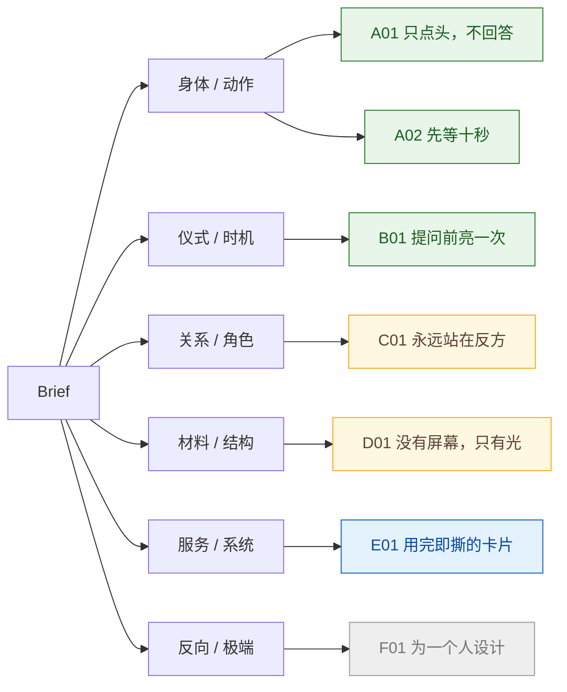
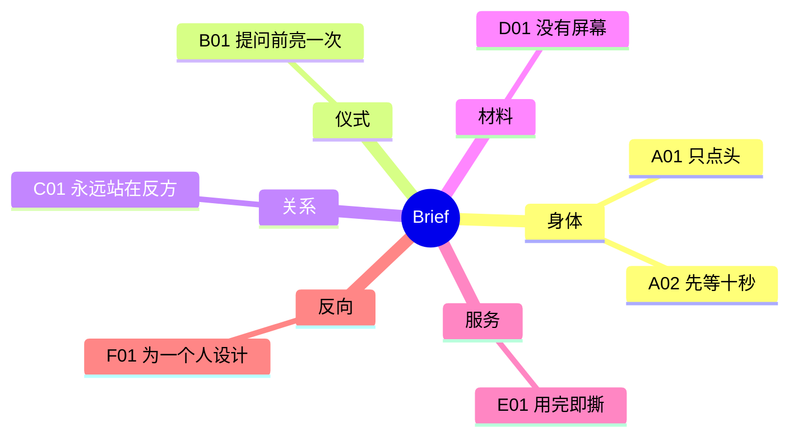
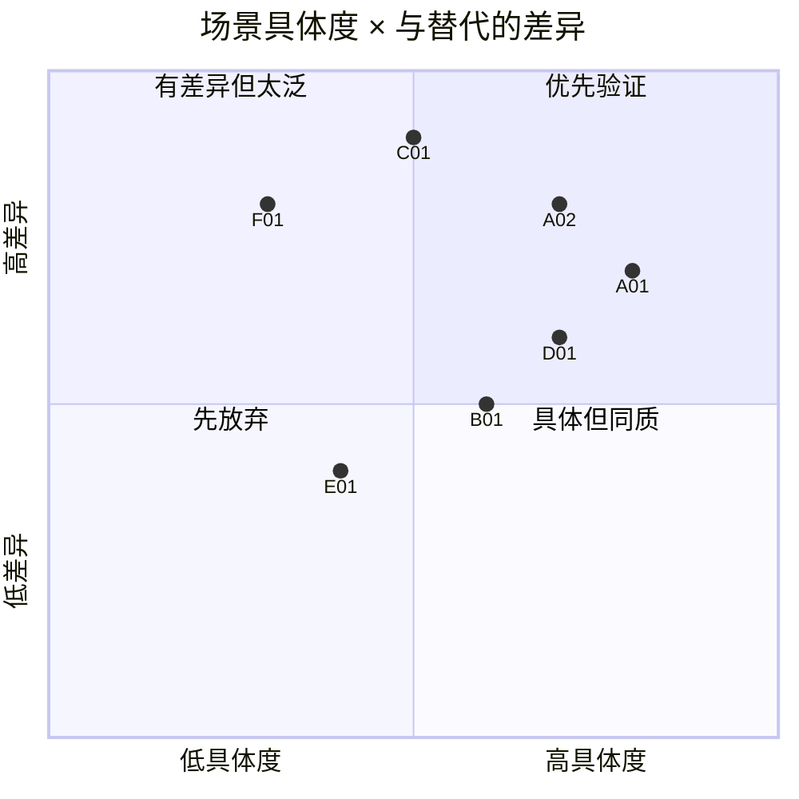

# Visual Map

Markdown is the source of truth. Deliver the offline canvas by default, following `references/interactive-tree-flow.md`. Use the following Mermaid/ASCII examples for the Markdown fallback and the print recipe only when requested. Replace all example IDs and values with the current run’s records.

The map must show **cards and status**, not a decorative "thinking" animation.

For a reframed run, generate the same Markdown tree from the actual readings in the brief: root → reading question → card IDs. Keep readings with an open check visible even if they have no cards. The lens diagrams below illustrate a standard run.

## Status legend

- `live` — green; eligible for shortlist.
- `needs-evidence` — yellow; structurally sound, evidence missing.
- `duplicate` — blue; points to the canonical card.
- `killed` — grey; keep the reason visible.

## 1. Structure map (Mermaid flowchart)



## 2. Mind map (Mermaid mindmap)



Mindmap cannot carry status colours in every renderer. Pair it with the table or flowchart.

## 3. Convergence quadrant (Mermaid)



Use the shortlist to decide, not the quadrant alone. A high-difference / low-specificity card is a provocation, not a product.

## 4. ASCII fallback

```text
Brief
├─ 身体 / 动作
│  ├─ A01 [live] 只点头，不回答
│  ├─ A02 [live] 先等十秒
│  └─ A03 [killed] 会替你回答
├─ 仪式 / 时机
│  ├─ B01 [live] 提问前亮一次
│  └─ B02 [needs] 回答后复盘
├─ 关系 / 角色
│  ├─ C01 [needs] 永远站在反方
│  └─ C02 [dup→C01] 唱反调
├─ 材料 / 结构
│  └─ D01 [live] 没有屏幕，只有光
├─ 服务 / 系统
│  └─ E01 [dup→D01] 无 App
└─ 反向 / 极端
   └─ F01 [killed] 为所有人设计
```

## 5. Interactive sheet vs static print

If the user says the visual is too large to read, asks to open it, or wants a line-connected mind-map feel, use `references/interactive-tree-flow.md`. Do not screenshot it into a bitmap.

For a print-only request, this is the static pipeline.

Pipeline:

1. Parse `cards/*.md` frontmatter plus `04_SHORTLIST.md` and `05_HANDOFF.md` into `visual/manifest.json`.
2. Render `visual/atlas-print.html`: one group per recorded reading or lens; every card stays visible; each card shows title, promise, role, gap, family, score, status colour, and shortlist rank/ring.
3. Add three bottom panels: shortlist (title + why + kill), convergence funnel (cards → families → live → shortlist → handoff), evidence/constraints (why-now numbers, hard constraints, legend).
4. Screenshot with Chrome headless at 2400×1600 landscape (3:2; A2-width print); render a 2× PNG for print.
5. Rebuild after every card edit. Never hand-edit the HTML.

```bash
chrome --headless=new --disable-gpu --hide-scrollbars \
  --force-device-scale-factor=1 --window-size=2400,1600 \
  --virtual-time-budget=4000 \
  --screenshot=visual/atlas.png \
  "file:///.../visual/atlas-print.html"
```

For print, repeat with `--force-device-scale-factor=2` and write `atlas@2x.png`.

Pitfalls:

- At 2400×1600, body text below ~14px is unreadable on A2; captions below ~11px fail. Increase type before adding more content.
- Cards have fixed heights; use line-clamp for role/gap and inspect a 1200px preview for overlap.
- Mermaid cannot control status colour, family, and shortlist rank together; use HTML/CSS for the final sheet.
- **Bitmap-first**: a large PNG is not a readable deliverable for 18+ cards; use the interactive HTML and a `FIT` control.
- Do not let the sheet become a deck or a visual identity. No PPT/PDF.
- Report family count with a caveat: distinct family labels can still hide semantic overlap.

## Rules

- Every node must map to a card ID and a status.
- Killed cards stay visible; do not tidy them away.
- Duplicate cards point to a canonical card.
- Do not draw a branch that has no card behind it.
- Do not use a map as evidence. The map shows the search space; the cards carry the claims.
